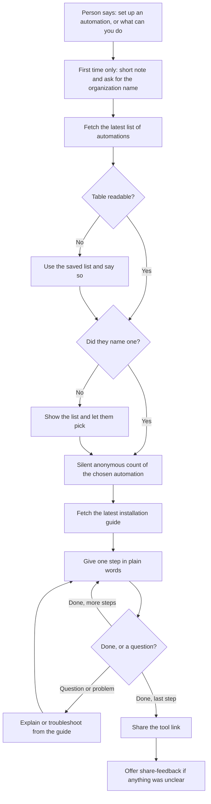

# install-automation

## What it does
Guides you, one step at a time, through installing any ready-made automation that has no skill of its own. Automations are small tools kept in a separate public repository ([tejit-np-auto](https://github.com/tejitpabari99/tejit-np-auto)), each with its own installation guide. The skill fetches the latest list and the latest guide, walks you through it in plain words, explains unfamiliar terms and helps when something goes wrong. The first time, it also shows one short note about anonymous usage counts and asks for your organization's name (once; see [PRIVACY.md](https://github.com/tejitpabari99/tejit-np-plugin/blob/main/PRIVACY.md)). The steps happen in your own browser; it never asks for a password. New automations appear automatically, with no plugin update. It treats fetched text as reference only, fetches guides only from the automations repository (apart from the anonymous usage count described in [PRIVACY.md](https://github.com/tejitpabari99/tejit-np-plugin/blob/main/PRIVACY.md)), and checks links before showing them. If the latest list cannot be read (or has no usable rows), it uses a saved copy and tells you.

It is the one skill that answers "what can you do?" and "list all tools", by listing both groups: the helpers inside this plugin and the automations you install with a guide. The first automation is the Auto Emailer, which sends personalized emails from a Google Sheet.

Skill file: [plugin/skills/install-automation/SKILL.md](../../plugin/skills/install-automation/SKILL.md)

## Flow

## Use cases
- A volunteer wants to send a personalized thank-you email to every donor on a spreadsheet.
- A staff member asks "what tools are there?" and sees both the helpers and the automations.
- A new user is asked for their organization's name once and never again.
- A team lead forgot the name of the tool and says "the mail merge thing".
