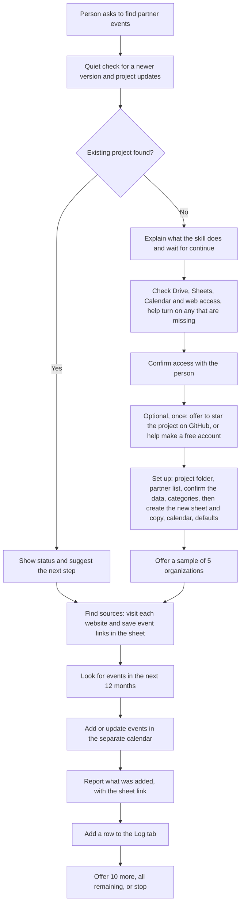

# partner-event-finder

## What it does
You have a list of partner organizations. This skill visits their public websites, finds where they announce fundraising events (galas, auctions, walks and so on), saves the links in a Google Sheet, and adds the events to a separate Google Calendar your team can share.

It works in rounds of at most 20 organizations. The first run is a sample of 5. The first time, it also offers an optional extra: starring the project on GitHub (and helping you make a free account if you want one). It is optional. Events it finds are added straight to the separate project calendar, and it tells you what it added. Your original list is only read. Nothing is deleted.

Skill file: [plugin/skills/partner-event-finder/SKILL.md](../../plugin/skills/partner-event-finder/SKILL.md)

## Flow

## Use cases
- A development team wants to know which partner organizations are holding galas or auctions so staff can attend.
- A coalition tracks community fundraising walks across member organizations in one shared calendar.
- A volunteer refreshes the calendar every few months to catch newly announced dates.
- A board asks "what is coming up this year?" and gets a calendar to look at.
