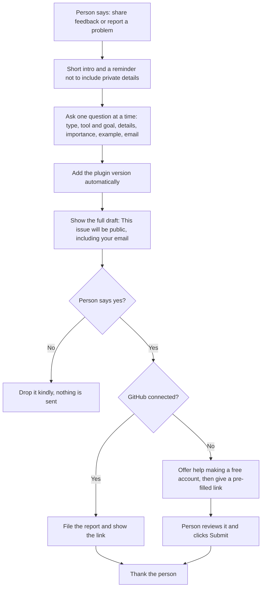

# share-feedback

## What it does
Helps you tell the maintainer about a problem, an idea or something that could work better. It asks a few short questions, shows you the full message, and sends it only after you say yes. Reports are public, so it reminds you not to include donor details or other private information.

If GitHub is connected, it sends the report for you. If not, it gives you a link with the form already filled in, and you click Submit. A free GitHub account is needed for that last click, and the skill can guide you through making one.

Skill file: [skills/share-feedback/SKILL.md](../../skills/share-feedback/SKILL.md)

## Flow

## Use cases
- A staff member hits an error halfway through setup and wants it fixed.
- A volunteer thinks a step is confusing and suggests clearer wording.
- A team lead asks for a new helper, for example for volunteer scheduling.
