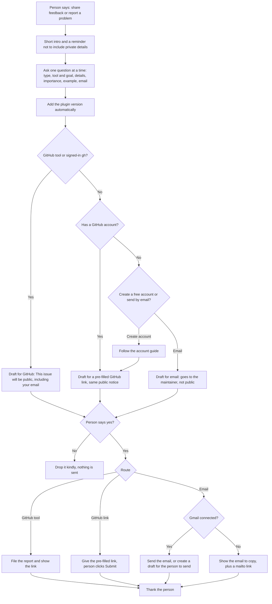

# share-feedback

## What it does
Helps you tell the maintainer about a problem, an idea or something that could work better. It asks a few short questions, shows you the full message, and sends it only after you say yes. Please leave out donor details or other private information.

There are three ways it can reach the maintainer. If GitHub is connected, it files the report for you (public, including your email). If not, and you have a GitHub account, it gives you a link with the form already filled in and you click Submit. If you have no account, you can create a free one (the skill guides you) or send it by email instead. Email goes only to the maintainer and is not public. With Gmail connected it can send for you; otherwise it shows the email to copy, plus a mailto link.

Skill file: [skills/share-feedback/SKILL.md](../../skills/share-feedback/SKILL.md)

## Flow

## Use cases
- A staff member hits an error halfway through setup and wants it fixed.
- A volunteer thinks a step is confusing and suggests clearer wording.
- A team lead asks for a new helper, for example for volunteer scheduling.
