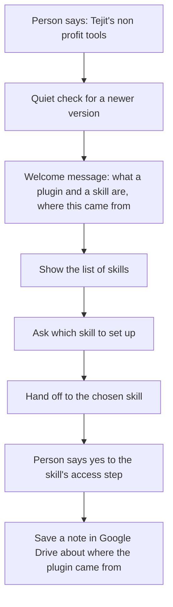

# start

## What it does
The friendly front door. It explains in plain words what a plugin and a skill are, shows where the plugin came from, lists the skills, and hands off to the one you pick. After you agree to the skill's access step, it saves a small note in Google Drive recording where the plugin came from.

Skill file: [plugin/skills/start/SKILL.md](../../plugin/skills/start/SKILL.md)

## Flow

## Use cases
- A volunteer opens the tools for the first time and wants to know what is available.
- A staff member forgot the skill name and asks "what can you do?".
- A team lead wants to see where the plugin came from before trusting it.
